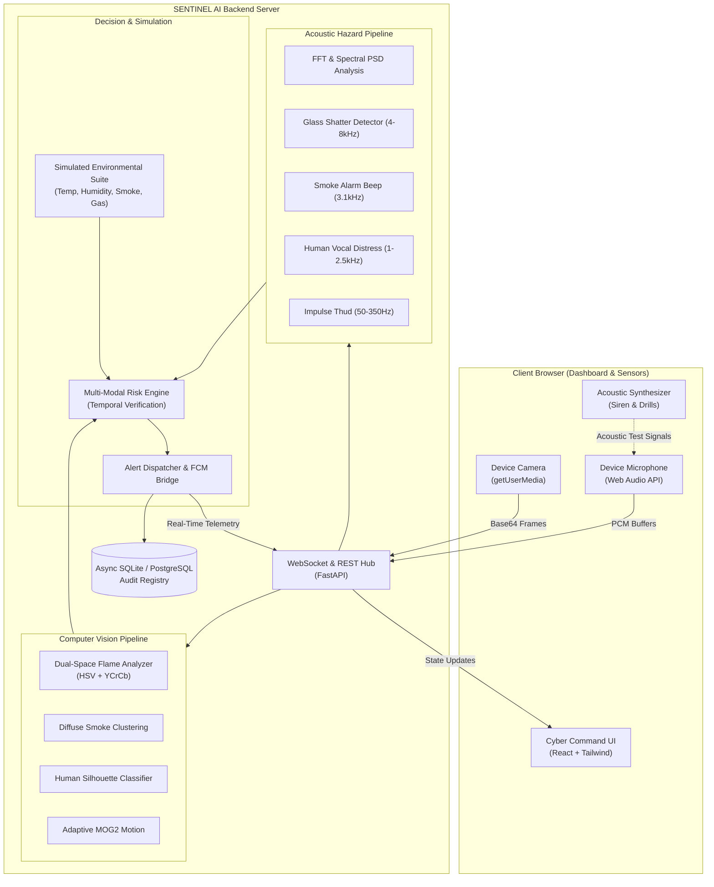

# 🛡️ SENTINEL AI

> **"Your Room. Your Safety. Your AI Guardian."**


-F59E0B?style=for-the-badge)

An intelligent, autonomous, software-only indoor safety monitoring application. **SENTINEL AI** transforms ordinary commodity webcams and laptop/desktop microphones into an advanced guardian station. It continuously analyzes visual and acoustic data, cross-verifies hazards across multiple sensory modalities, and alerts users before minor anomalies escalate into critical emergencies.

---

## ⚡ Key Highlights (Software-Only Architecture)

- **Zero Physical IoT Hardware Required:** No Arduino, ESP32, breadboards, or external sensors required. All optical and acoustic analysis is performed directly on the host computer.
- **Computer Vision Engine:** Detects visible flames, smoke influx, human occupancy, and erratic / unusual motion with static orange light suppression.
- **Acoustic Safety Guardian:** Analyzes high-frequency brittle transients and harmonic signatures to detect glass breaking, 3.1kHz smoke alarms, fire sirens, human distress screams, and heavy physical impacts.
- **Multi-Modal Risk Engine:** Fuses visual, acoustic, and environmental evidence using temporal verification windows and emergency convergence multipliers.
- **Clearly Labelled Environmental Simulation:** Mathematically models temperature, humidity, smoke particulates (PPM), and combustible gas (PPM) with interactive hazard injection drills.
- **Zero-Leak Ephemeral Privacy:** 100% in-memory processing. Video frames and raw audio streams are never recorded or written to disk.

---

## 📋 Table of Contents

1. [Architecture Overview](#-architecture-overview)
2. [Core Features](#-core-features)
   - [1. Live Camera Monitoring](#1-live-camera-monitoring)
   - [2. AI Sound Monitoring](#2-ai-sound-monitoring)
   - [3. AI Fire & Smoke Detection](#3-ai-fire--smoke-detection)
   - [4. Intelligent Risk Engine](#4-intelligent-risk-engine)
   - [5. Simulated Environmental Suite](#5-simulated-environmental-suite)
   - [6. Alert Management & Emergency Dispatch](#6-alert-management--emergency-dispatch)
   - [7. Safety Testing & Simulation Center](#7-safety-testing--simulation-center)
3. [Quick Start & Installation](#-quick-start--installation)
4. [Project Structure](#-project-structure)
5. [API Documentation](#-api-documentation)
6. [Testing & Verification](#-testing--verification)
7. [Privacy & Security Guarantees](#-privacy--security-guarantees)

---

## 🏗️ Architecture Overview



---

## 🚀 Core Features

### 1. Live Camera Monitoring
- Prompts for explicit camera access (`navigator.mediaDevices.getUserMedia`).
- Renders live camera feed with real-time bounding box canvas overlay:
  - **Red Glowing Boxes:** Confirmed flames with percentage confidence.
  - **Sky-Blue Dashed Boxes:** Diffuse smoke plumes.
  - **Cyan Boxes:** Human occupants in monitored zone.
- Real-time FPS counter, resolution indicator, and one-click **Disable / Enable Cam** controls.
- Automatic camera failure resilience handling with user recovery diagnostics.

### 2. AI Sound Monitoring
- Requests microphone permission and processes streaming audio buffers using Web Audio API and Scipy/Librosa spectral processing.
- Continuously classifies audio into 5 critical safety categories:
  1. **Glass Breaking:** Analyzes rapid crest factor spikes and high-frequency brittle energy ($4.5\text{kHz} - 8.5\text{kHz}$).
  2. **Smoke Alarm:** Detects standard piezoelectric 3.1kHz pulsed beep patterns (T3 tone).
  3. **Fire Siren:** Detects sustained high-energy siren sweeps ($2.8\text{kHz} - 3.8\text{kHz}$).
  4. **Human Screaming:** Identifies high vocal tract harmonics ($900\text{Hz} - 2500\text{Hz}$) with emotional distress acoustic roughness.
  5. **Loud Impact / Thud:** Detects low-frequency kinetic explosions ($50\text{Hz} - 350\text{Hz}$) exceeding ambient thresholds.
- Live animated frequency spectrogram visualizer and ambient decibel (dB) meter.

### 3. AI Fire & Smoke Detection
- Uses a dual color-space algorithm combining **HSV** (Hue $0-30^\circ$, high saturation, high value) and **YCrCb** ($Y \ge Cb, Cr \ge Cb, Cr \ge 135$).
- **Anti-False-Positive Filter:** Differentiates real turbulent fire from static orange lights, street lamps, and bulbs by analyzing boundary contour circularity ($4\pi \cdot \text{Area} / \text{Perimeter}^2$). Perfectly round or elliptical light sources ($> 0.75$) are suppressed.
- Smoke detection isolates grayish, low-saturation chrominance clusters ($|Cr - 128| < 16$ and $|Cb - 128| < 16$) with diffuse dispersion.

### 4. Intelligent Risk Engine
- Performs multi-modal fusion of optical, acoustic, and environmental evidence.
- Categorizes safety into four standardized levels:
  - `NORMAL`: All sensory channels within clean baselines ($0.0 - 0.25$).
  - `WARNING`: Isolated sensory anomaly (e.g. unexpected motion surge or moderate ambient noise) ($0.28 - 0.52$).
  - `HIGH RISK`: Confirmed single-channel hazard (e.g. verified flame or confirmed glass breaking) ($0.52 - 0.78$).
  - `CRITICAL`: Multi-sensor convergence (e.g. Flame + Smoke Alarm sound + Elevated Temp) ($0.78 - 1.0$).
- **Temporal Verification:** Requires multi-frame persistence across consecutive analysis windows to filter transient noise spikes.

### 5. Simulated Environmental Suite
- **Mandatory Simulation Notice:** Physical sensors are absent; telemetry is modeled mathematically:
  - **Temperature:** Celsius (°C) with heat gradient indicators.
  - **Relative Humidity:** % moisture content.
  - **Smoke Particulates:** Clean ambient baseline ($\sim 15$ PPM) up to hazardous smoke ($\ge 250$ PPM).
  - **Combustible Gas:** Ambient hydrocarbon trace ($\sim 30$ PPM) up to explosive leak ($\ge 500$ PPM).
- **Interactive Drill Injection:** One-click simulation triggers:
  - 🔥 Heat Surge (68°C)
  - 💨 Smoke Influx (340 PPM)
  - ☣ Combustible Gas Leak (620 PPM)
  - 🚨 Catastrophe Drill (Multi-Hazard Convergence)
  - 🔄 Reset to Baseline

### 6. Alert Management & Emergency Dispatch
- **Critical Alert Modal:** Fullscreen high-urgency overlay banner with flashing emergency strobe and audible dual-tone siren.
- **Siren Mute / Unmute:** Operators can silence the alarm tone while evaluating the incident.
- **Emergency Contacts:** Add, edit, and delete first responders or building security.
- **One-Touch Emergency Dispatch:** Simulates automated priority voice call and SMS dispatch to configured emergency contacts.
- **Historical Audit Log:** Searchable and filterable registry of incidents with timestamps, room zones, confidence breakdown, and operator acknowledgement stamps.

### 7. Safety Testing & Simulation Center
Includes dedicated tests for all 8 mandatory verification criteria:
1. Fire detection algorithm test.
2. Smoke detection algorithm test.
3. Glass breaking acoustic classifier test (includes live audio playback!).
4. Smoke alarm sound test (includes audible 3.1kHz test sound!).
5. Human occupancy classifier test.
6. Camera permission refusal simulation.
7. Microphone denial fallback test.
8. Network drop & WebSocket reconnection test.

---

## 📦 Quick Start & Installation

### Prerequisites
- Python 3.10+
- Modern Web Browser (Chrome, Edge, Firefox, Brave)
- Built-in or USB Webcam & Microphone

### Step 1: Clone or Navigate to Project
```bash
cd C:\Users\naina\.gemini\antigravity\scratch\sentinel-ai
```

### Step 2: Install Python Dependencies
```bash
pip install -r requirements.txt
```

### Step 3: Launch SENTINEL AI
Run the unified single-command launcher:
```bash
python run_sentinel.py
```

The application will start the FastAPI backend and automatically open your default browser to:
👉 **`http://127.0.0.1:8000`**

Click **"START SURVEILLANCE"** to grant camera and microphone access.

---

## 📂 Project Structure

```
sentinel-ai/
├── README.md                      # Complete system documentation
├── requirements.txt               # Backend Python dependencies
├── run_sentinel.py                # Unified one-click application launcher
├── backend/
│   ├── app/
│   │   ├── __init__.py
│   │   ├── main.py                # FastAPI entrypoint, WebSocket hub, static file serving
│   │   ├── config.py              # System thresholds, zone names, privacy policies
│   │   ├── database.py            # Async SQLite database engine & CRUD repositories
│   │   ├── models/                # Data structures for Alerts and Contacts
│   │   ├── schemas/               # Pydantic schemas for Detections and Telemetry
│   │   ├── core/
│   │   │   ├── risk_engine.py     # Multi-modal fusion risk engine with temporal verification
│   │   │   ├── simulation_engine.py # Simulated environmental telemetry engine
│   │   │   └── notification_engine.py # Real-time alert hub & FCM notification bridge
│   │   ├── vision/
│   │   │   ├── fire_detector.py   # Dual color-space flame & smoke detection
│   │   │   ├── person_detector.py # Human silhouette occupancy classifier
│   │   │   └── motion_detector.py # MOG2 adaptive background motion analyzer
│   │   ├── audio/
│   │   │   ├── audio_classifier.py# Librosa/Scipy acoustic hazard classifier
│   │   │   └── audio_processor.py # In-memory PCM buffer streaming processor
│   │   ├── api/
│   │   │   └── v1/
│   │   │       ├── monitoring.py  # Live camera/audio frame ingestion & WebSocket
│   │   │       ├── alerts.py      # Alert history, stats, and acknowledgement
│   │   │       ├── sensors.py     # Simulated sensor telemetry and drill injection
│   │   │       ├── contacts.py    # Emergency contact configuration & test dispatch
│   │   │       ├── testing.py     # Diagnostic automated safety testing endpoints
│   │   │       └── settings.py    # Safety thresholds and room configuration
│   │   └── static/
│   │       └── index.html         # Rich React 18 single-page application dashboard
│   └── tests/
│       ├── test_vision.py         # Unit tests for flame, smoke, and motion
│       ├── test_audio.py          # Unit tests for glass shatter, alarm, and silence
│       ├── test_risk_engine.py    # Tests for multi-modal convergence & risk levels
│       └── test_api.py            # End-to-end integration tests for FastAPI routes
└── frontend/                      # Modular React + Vite + Tailwind source tree
    ├── package.json
    ├── vite.config.js
    ├── index.html
    └── src/
        ├── main.jsx
        ├── App.jsx
        ├── components/
        │   ├── Navbar.jsx
        │   ├── Sidebar.jsx
        │   ├── LiveMonitor.jsx
        │   ├── RiskGauge.jsx
        │   ├── AudioSpectrogram.jsx
        │   ├── EnvironmentalSensors.jsx
        │   ├── CriticalAlertModal.jsx
        │   ├── AlertHistory.jsx
        │   ├── EmergencyContacts.jsx
        │   ├── TestingCenter.jsx
        │   └── SettingsView.jsx
        ├── hooks/
        │   ├── useCamera.js
        │   ├── useMicrophone.js
        │   └── useSentinelSocket.js
        └── utils/
            ├── audioSynthesizer.js
            └── constants.js
```

---

## 📡 API Documentation

| Method | Endpoint | Description |
|---|---|---|
| `GET` | `/api/health` | Health check and system readiness |
| `POST` | `/api/v1/monitor/frame` | Ingest and process a single camera frame |
| `POST` | `/api/v1/monitor/audio` | Classify an in-memory PCM audio chunk |
| `POST` | `/api/v1/monitor/fuse` | Multi-modal fusion of optical, audio, and sensors |
| `WS` | `/api/v1/monitor/ws` | Bi-directional streaming WebSocket channel |
| `GET` | `/api/v1/alerts` | Filtered list of historical incident alerts |
| `POST` | `/api/v1/alerts/{id}/acknowledge` | Mark an alert incident as acknowledged |
| `GET` | `/api/v1/alerts/stats` | Summary statistics of unacknowledged alerts |
| `GET` | `/api/v1/sensors/current` | Current simulated atmospheric readings |
| `POST` | `/api/v1/sensors/inject` | Inject simulated hazard drills (Fire, Smoke, Gas) |
| `POST` | `/api/v1/sensors/reset` | Reset simulated environment to baseline |
| `GET` | `/api/v1/contacts` | List emergency first responder roster |
| `POST` | `/api/v1/contacts/{id}/test-alert` | Simulate emergency call / SMS dispatch |
| `POST` | `/api/v1/testing/run-test/{name}` | Execute individual diagnostic test drill |
| `GET` | `/api/v1/testing/run-all` | Execute complete automated diagnostic sweep |

---

## 🧪 Testing & Verification

To run all automated test suites directly from the terminal:

```bash
cd backend
python -m tests.test_vision
python -m tests.test_audio
python -m tests.test_risk_engine
python -m tests.test_api
```

### In-Browser Interactive Testing
Navigate to the **Diagnostic Test Center** tab in the UI to trigger all 8 interactive tests:
- Click **"Audible Sound"** under Glass Breaking to hear synthesized glass shattering and verify the audio classifier.
- Click **"Audible Sound"** under Smoke Alarm to hear the 3.1kHz test beep.
- Click **"Run All Diagnostic Tests"** for a full system audit report.

---

## 🔒 Privacy & Security Guarantees

1. **Explicit Permission Model:** Camera and microphone streams are never accessed without prior user consent.
2. **Ephemeral Volatile Memory:** Video frames and audio waveforms are analyzed in RAM buffers and immediately garbage collected. No video files or audio recordings are saved to disk.
3. **Local Processing:** All computer vision and audio inference occurs locally on your machine.
4. **Master Privacy Killswitch:** Clicking **"STOP SURVEILLANCE"** immediately terminates all camera and microphone hardware tracks.

---

<p align="center">
  <strong>SENTINEL AI</strong> — Built with excellence for intelligent room safety.
</p>
